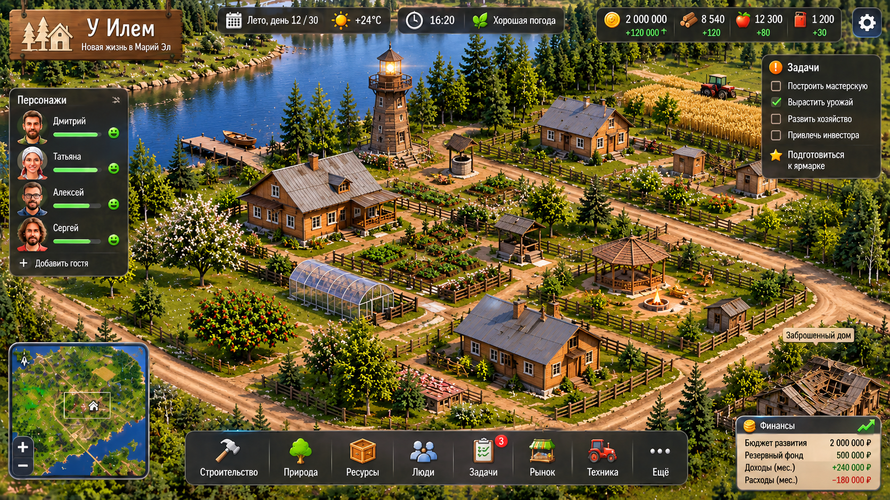

# U Ilem 4.0 — CANONICAL MAP SOURCE LOCK

**Do not ask the user to upload or reconfirm the map again.**

The one and only approved main map is the existing Dropbox file:

- Name: `U_Ilem_4_0_visual_base.png`
- Dropbox path: `/04 Творческие проекты/У Илем 4.0/U_Ilem_4_0_visual_base.png`
- Dropbox file ID: `id:cKyVcPUdtfIAAAAAAAADRQ`
- Size: `3,514,752` bytes
- Dropbox content_hash: `8feb8d00f10d1d0243208e83ba767137e5bf5d04504a912ffaa566596ec64525`
- Repository copy: `U_Ilem_4_0/U_Ilem_4_0_visual_base.png`
- GitHub blob SHA: `f2a308f101daaab0d010f13d1127f331929ba2b0`

## Runtime contract

The active game page is `U_Ilem_4_0/U_Ilem_4_0_base.html` and must load exactly:

```html

```

The local server's `ROOT` is its own directory, so the PNG must remain alongside the server and base HTML. Do not substitute old maps, embedded legacy images, other approved-map files, or the separate close-up/detail style reference. If the image fails to appear, debug the path, static-file serving, caching, and package contents. Never ask the user to resend or reconfirm this already-supplied Dropbox file.

The detailed-object reference is only a style guide for individual assets. It is not the main map.

See `ЖУРНАЛ_ИЗМЕНЕНИЙ.md`, entry 0003, for the full decision record and verification limits.
